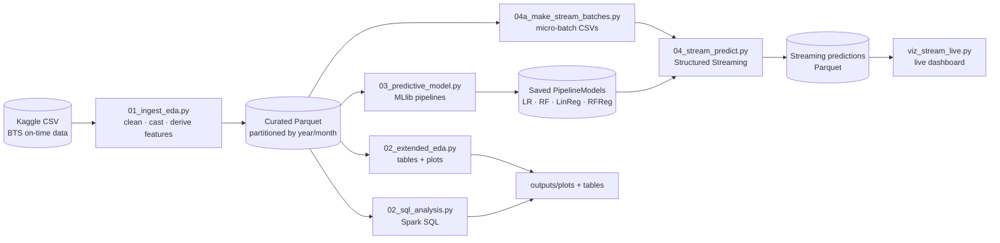

# US Flight Delay & Cancellation Analysis (2019–2023)

An end-to-end **Apache Spark** big-data pipeline over **2.9 million U.S. domestic flights**: ingestion and cleaning to partitioned Parquet, exploratory and Spark SQL analytics, **MLlib** delay prediction (ROC-AUC **0.93**), and **Structured Streaming** that scores simulated live flight feeds in micro-batches.


## Problem

Flight delays cost airlines and passengers billions every year. Operations teams need to know **where** delays concentrate (airlines, routes, airports, seasons), **whether** a flight is likely to arrive late, and how to get that signal **continuously** as new flight records arrive, not just in a monthly report. This project builds that pipeline at scale with Spark.

## Architecture



## Tech stack

| Area | Tools |
|---|---|
| Processing | Apache Spark (PySpark), Spark SQL, Parquet |
| Machine learning | Spark MLlib: Logistic Regression, Random Forest (classification and regression), Linear Regression; StringIndexer → OneHotEncoder → VectorAssembler pipelines |
| Streaming | Spark Structured Streaming (file source, micro-batches) |
| Visualization | Matplotlib, pandas |
| Orchestration | Bash (`run.sh`, `run_stream_predict.sh`), `.env` configuration, Git LFS for saved models |

## My role

Group project (5 members) for *Cloud Computing for Data Analysis* at UNC Charlotte. Team: Navya Reddy Thadisana, Poojitha Jayareddygari, Sahit Ceeka, Sai Kiran Jagini, Jeevith Doddalingegowda Rama.

**My focus was the code implementation (30 of the repository's 41 commits).** I wrote every script in `src/` and the pipeline runners: Spark ingestion and cleaning, EDA and Spark SQL analysis, MLlib model training and evaluation, the streaming micro-batch generator, the Structured Streaming prediction job, the visualizations, and `run.sh` / `run_stream_predict.sh`.

## Dataset

[Flight Delay and Cancellation Dataset (2019–2023)](https://www.kaggle.com/datasets/patrickzel/flight-delay-and-cancellation-dataset-2019-2023) on Kaggle, derived from U.S. Bureau of Transportation Statistics on-time data. We used the **~3M-row sample**, covering **Jan 2019 – Aug 2023**. The column dictionary is in [`data/raw/dictionary.html`](data/raw/dictionary.html).

The raw CSV is too large to commit. Download it from Kaggle and place it in `data/raw/`.

| Column | Description |
|---|---|
| `FL_DATE` | Flight date |
| `AIRLINE`, `AIRLINE_CODE` | Carrier name / code |
| `ORIGIN`, `DEST` | Airports |
| `DEP_DELAY`, `ARR_DELAY` | Delay in minutes |
| `CANCELLED`, `DIVERTED` | Event flags |
| `DISTANCE` | Distance in miles |

## How to run

**Prerequisites:** Python 3.8+, Java 17 (for Spark), and [Git LFS](https://git-lfs.com) to pull the saved models.

```bash
git lfs install
git clone https://github.com/Poojitha220403/US-Flight-Delay-and-Cancellation.git
cd US-Flight-Delay-and-Cancellation

python3 -m venv .venv && source .venv/bin/activate
pip install -r requirements.txt
cp .env.example .env          # paths for raw, curated, tables, plots, stream dirs

# Place the Kaggle CSV in data/raw/, then run the batch pipeline:
chmod +x run.sh && ./run.sh   # ingest → EDA → SQL → train model → make stream batches

# Streaming predictions + live dashboard:
chmod +x run_stream_predict.sh && ./run_stream_predict.sh
python src/viz_stream_live.py
```

> `run.sh` installs OpenJDK with `apt-get` and sets a Linux `JAVA_HOME`, so it targets Linux or WSL. On macOS, install Java 17 yourself (e.g. `brew install openjdk@17`) and export `JAVA_HOME` before running.
>
> If `data/raw/` is empty, `run.sh` skips ingestion and reuses the curated Parquet already in `outputs/curated/`.

## Results

All numbers below come from the files in `outputs/`.

### Delay prediction (arrival delay > 15 min)

Train/test split: **2,039,682 / 874,120 flights**. Features: airline, origin, destination, day of week (one-hot), departure delay, distance, month, year.

| Model | Task | Metric |
|---|---|---|
| **Logistic Regression** | Classification | **ROC-AUC 0.933** |
| Random Forest | Classification | ROC-AUC 0.911 |
| **Linear Regression** | Regression (delay minutes) | **RMSE 13.23 min, R² 0.936** |
| Random Forest Regressor | Regression | RMSE 22.51 min, R² 0.814 |

Logistic-regression confusion matrix on the test set:

| | Predicted on time | Predicted delayed |
|---|---|---|
| **Actually on time** | 707,073 | 12,576 |
| **Actually delayed** | 42,413 | 112,058 |

That gives **accuracy 93.7%, precision 89.9% and recall 72.5%** for delayed flights. Departure delay dominates the Random Forest feature importance (**0.992**). The model is best read as "given how late a flight left, will it arrive more than 15 minutes late?"

### Operational insights

- **Seasonality:** June (10.1 min) and July (9.5 min) have the worst average arrival delays; September and November are near zero.
- **Trend:** average arrival delay fell to −5.0 min in 2020 (pandemic-era low traffic), then climbed every year to **9.4 min in 2023**.
- **Airlines:** Allegiant (13.3 min), JetBlue (12.3) and Frontier (11.1) are the most delayed; Delta (1.1), Republic (0.6) and Endeavor (−1.3) are the least.
- **Routes and airports:** DEN→ASE is the most delayed route (21.2 min); Aspen (ASE) is the most delayed origin airport (22.2 min).
- **Distance doesn't predict delay:** the distance–arrival-delay correlation is ≈ 0.002.

## Screenshots

| Average delay by airline | Monthly delay pattern |
|---|---|
|  |  |

| Random Forest feature importance | Departure vs. arrival delay |
|---|---|
|  |  |

**Structured Streaming output:** actual vs. predicted delay probability per airline across micro-batches.


## Limitations & future work

- **Cancelled flights are dropped during cleaning**, so `cancellations_by_code.csv` and `cancellations_pie.png` contain a single blank category. Cancellation analysis needs a separate path that keeps those rows.
- The classifier relies heavily on departure delay. A pre-departure model (schedule, route, weather and congestion features only) would be more useful for planning.
- Weather and ATC constraints aren't modeled explicitly.
- **Next steps:** gradient-boosted trees with tuning at scale, and running the streaming job on a managed Spark cluster (EMR / Dataproc) instead of local mode.

## Deliverables

- 📄 Final report: [`Documentation/Cloud Course Project Dcoumentation.pdf`](Documentation/Cloud%20Course%20Project%20Dcoumentation.pdf)
- 📊 Slides: [`Documentation/Group 5 - Flight Delay & Cancellation Analysis.pdf`](Documentation/Group%205%20-%20Flight%20Delay%20%26%20Cancellation%20Analysis.pdf)
- 🎥 Technical walkthrough (~20 min): `Documentation/Cloud Course Project Recording.mov`

## Repo structure

```
.
├── src/
│   ├── 01_ingest_eda.py           # raw CSV → cleaned, partitioned Parquet
│   ├── 02_extended_eda.py         # EDA tables + plots
│   ├── 02_sql_analysis.py         # Spark SQL analysis
│   ├── 03_predictive_model.py     # MLlib classification / regression
│   ├── 04a_make_stream_batches.py # curated data → micro-batch CSVs (data/stream/)
│   ├── 04_streaming_demo.py       # streaming aggregation demo
│   ├── 04_stream_predict.py       # Structured Streaming + model scoring
│   ├── viz_model.py               # model plots
│   └── viz_stream_live.py         # live streaming dashboard
├── spark_pipeline/main_pipeline.py
├── outputs/
│   ├── curated/                   # Parquet, partitioned year=/month=
│   ├── tables/                    # EDA + SQL result CSVs
│   ├── plots/                     # PNG charts
│   ├── models/                    # saved PipelineModels + metrics (Git LFS)
│   └── stream_out/                # streaming predictions
├── data/raw/dictionary.html       # column dictionary (raw CSV not committed)
├── docs/                          # metrics + sample artifacts
├── Documentation/                 # report, slides, recording
├── run.sh                         # full batch pipeline
├── run_stream_predict.sh          # streaming + live predictions
├── requirements.txt
└── .env.example
```
